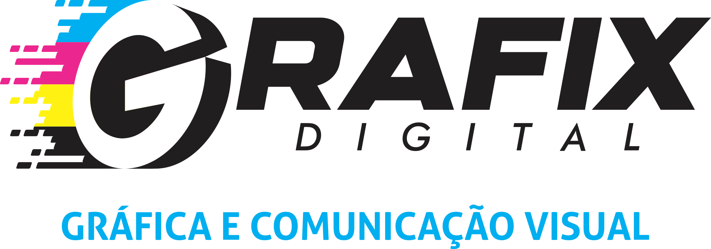

<p align="center">
  
</p>

<h1 align="center">Conversor</h1>

<p align="center">
  Ferramentas de PDF, imagem e PSD para a rotina de uma gráfica,<br />
  rodando <strong>100% no navegador</strong>: nenhum arquivo sai do computador.
</p>

<p align="center">
  
  
  
</p>

---

## Por que existe

Na Grafix chegam todo dia arquivos de clientes que o CorelDRAW recusa ou importa faltando partes, PSDs que só abrem no Photoshop e imagens que precisam de recorte. O **Conversor** reúne essas correções num app instalável, que funciona offline e trata cada arquivo como potencialmente hostil.

## Ferramentas

| Ferramenta                                                                                                                             | Situação            |
| -------------------------------------------------------------------------------------------------------------------------------------- | ------------------- |
| **Corrigir PDF para o CorelDRAW 27**: reescreve em PDF 1.4, remove conteúdo ativo e troca degradês que o Corel descarta por cor sólida | Planejada (Etapa 2) |
| **Remover fundo de imagem** com IA (BiRefNet, local, WebGPU/WASM) e editor de ajuste                                                   | Planejada (Etapa 3) |
| **PSD → PDF** mantendo DPI e modo de cor (inclusive CMYK)                                                                              | Planejada (Etapa 4) |
| **Editar PDF**: juntar, separar, extrair, girar, cortar por área, comprimir, PDF → imagem                                              | Planejada (Etapa 5) |
| **Imagens**: converter, redimensionar, imagens → PDF                                                                                   | Planejada (Etapa 6) |
| **CMYK** com perfil ISO Coated v2 (FOGRA39)                                                                                            | Planejada (Etapa 7) |

**Etapa atual: 1 (fundação).** Estrutura do projeto, PWA offline, cabeçalhos de segurança, infraestrutura de workers, interface (menu lateral, área de soltar arquivos, temas escuro e claro), testes e CI. As ferramentas já aparecem no app e conferem os arquivos recebidos; o processamento chega nas próximas etapas.

## Arquitetura

```
Página (Preact)                         Web Worker (um por tarefa)
──────────────                          ──────────────────────────
arquivo do cliente ──► runWorkerTask ──► defineWorkerTask ──► processa bytes
        ▲                  │  progresso / cancelar / tempo-limite      │
        └──── resultado ◄──┴──────────── mensagem validada ◄───────────┘
```

- **Tudo local.** O app é só um conjunto de arquivos estáticos; o processamento acontece no navegador.
- **Um worker por tarefa**, encerrado ao final: isola cada arquivo, libera memória e permite cancelar na hora.
- **Mensagens validadas** nos dois sentidos da fronteira página ↔ worker.
- **PWA** com atualização sob aviso ("Nova versão disponível"), nunca silenciosa.

Detalhes, requisitos e decisões: [`docs/ESPECIFICACAO.md`](docs/ESPECIFICACAO.md). Segurança: [`SECURITY.md`](SECURITY.md).

## Stack

[Vite](https://vite.dev) · [TypeScript](https://www.typescriptlang.org) (strict) · [Preact](https://preactjs.com) · [vite-plugin-pwa](https://vite-pwa-org.netlify.app) / Workbox · [Vitest](https://vitest.dev) · [Playwright](https://playwright.dev) · ESLint (com regras de segurança) · Prettier

## Estrutura

```
├─ .github/            CI (GitHub Actions) e Dependabot
├─ docs/               especificação e registro de decisões
├─ public/             _headers (segurança), ícones do PWA
├─ scripts/            geração de ícones/logos, cabeçalhos no preview
├─ src/
│  ├─ assets/          logos e símbolos
│  ├─ components/      menu lateral, área de soltar, lista de arquivos
│  ├─ pages/           tela de ferramenta e tela "Sobre"
│  ├─ lib/             tema, download, PWA, execução de workers
│  │  └─ shared/       código que roda na página e nos workers (erros, nomes, tipos, limites)
│  ├─ styles/          tokens de cor (temas escuro e claro)
│  ├─ tools/           registro das ferramentas e fila de arquivos
│  └─ workers/         tarefas pesadas, uma por arquivo
└─ tests/
   ├─ unit/            Vitest
   └─ e2e/             Playwright (Google Chrome)
```

## Desenvolvimento

Requisitos: **Node.js 24** e **Google Chrome**.

```bash
npm ci              # instala as versões exatas do package-lock
npm run dev         # servidor de desenvolvimento
npm run check       # formatação, lint, testes, build e testes ponta a ponta
```

| Comando                           | O que faz                                                   |
| --------------------------------- | ----------------------------------------------------------- |
| `npm run build`                   | Checa tipos e gera a build de produção em `dist/`           |
| `npm run preview`                 | Serve `dist/` com os mesmos cabeçalhos do Cloudflare Pages  |
| `npm test`                        | Testes unitários                                            |
| `npm run test:e2e`                | Testes ponta a ponta no Chrome (rode `npm run build` antes) |
| `npm run lint` / `npm run format` | ESLint / Prettier                                           |

Ícones e a versão clara do logo são gerados a partir do logo original:

```bash
python -I scripts/generate-brand-assets.py   # requer Pillow
```

## Publicação e instalação

Hospedado no **Cloudflare Pages** a partir da branch `main` (build `npm ci && npm run build`, saída `dist`). A hospedagem serve apenas os arquivos do app.

Para instalar: abrir o endereço no Chrome → ícone de instalar na barra de endereço → **Instalar**. O app abre em janela própria, funciona offline e avisa quando há versão nova.

## Licença

Projeto privado da Grafix – Gráfica e Comunicação Visual. Todos os direitos reservados. Componentes de terceiros: [`THIRD_PARTY_LICENSES.md`](THIRD_PARTY_LICENSES.md).
